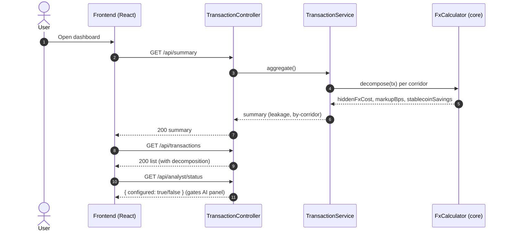
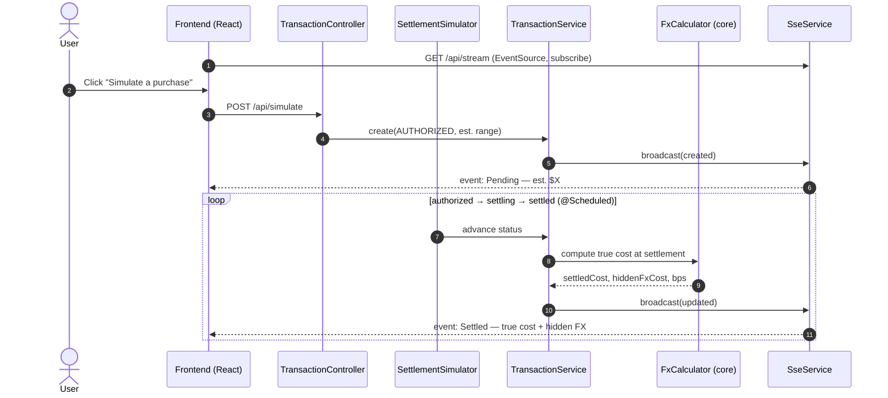
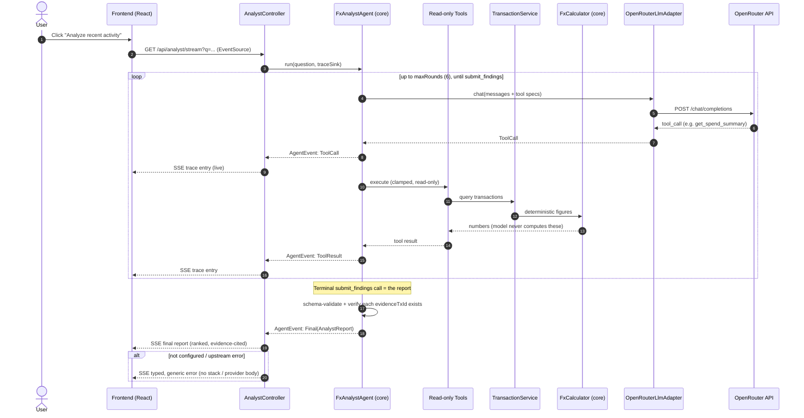

# Prism — Sequence Diagrams

Three flows: the dashboard load, the live settlement reveal, and the agentic AI analyst loop.
GitHub renders Mermaid natively; for slides, paste any block into https://mermaid.live to export PNG/SVG.

---

## 1. Dashboard load — FX decomposition + aggregates

---

## 2. Simulate a purchase → live settlement reveal (SSE)

---

## 3. Agentic FX Analyst — bounded tool-calling loop, streamed

---

### Talking points

- **Deterministic money** — every figure flows `Tools → TransactionService → FxCalculator`; the model only orchestrates, ranks and narrates.
- **Hexagonal boundary** — `FxAnalystAgent` (core) depends only on ports (`LlmClient`, `AgentTool`, `AgentTraceSink`, `FindingsSubmission`); `OpenRouterLlmAdapter` and the SSE controller are adapters.
- **Security by design** — read-only clamped tools, single egress URL, bounded loop, schema-validated output, evidence-id verification, typed generic errors.
